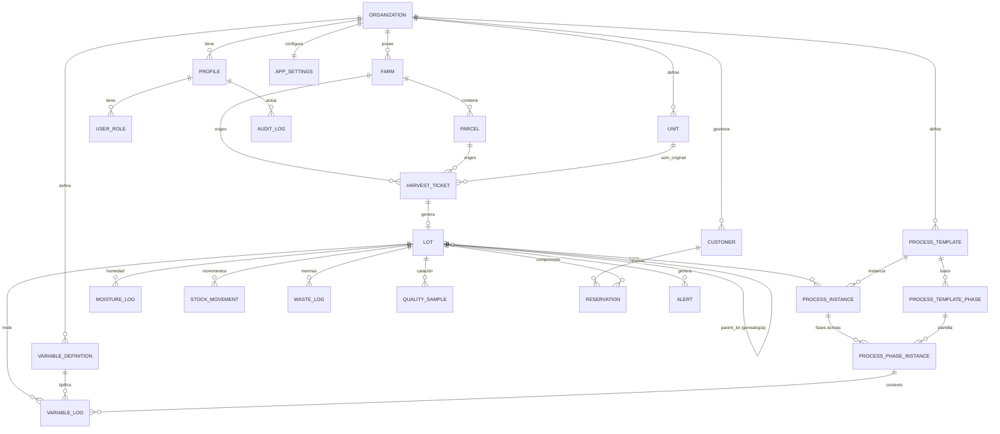

# Arquitectura de datos — Bitácora Café Pro

Este es el modelo de datos propuesto, mapeado 1:1 a las tablas Supabase cuando se conecte el backend. Actualmente vive en memoria (`mockDb`) + capa reactiva (`app-config-store.ts`) persistida en `localStorage`.

## Vista por dominios

```text
┌─────────────────────────────────────────────────────────────────┐
│  TENANCY & SEGURIDAD                                            │
│  organizations ── profiles ── user_roles (RBAC)                 │
└─────────────────────────────────────────────────────────────────┘
                │
┌───────────────┴─────────────────────────────────────────────────┐
│  CATÁLOGOS (configurables en Ajustes)                           │
│  farms → parcels │ units │ customers │ variable_definitions     │
│                  │        │           │ process_templates       │
│                  │        │           │   └─ template_phases    │
└─────────────────────────────────────────────────────────────────┘
                │
┌───────────────┴─────────────────────────────────────────────────┐
│  ENTRADA DE MATERIA PRIMA                                       │
│  harvest_tickets (kind = harvest | intake)                      │
│     └── convierte a → lots                                      │
└─────────────────────────────────────────────────────────────────┘
                │
┌───────────────┴─────────────────────────────────────────────────┐
│  PRODUCCIÓN Y TRAZABILIDAD                                      │
│  lots (parent_lot_id → genealogía)                              │
│    ├── process_instances → process_phase_instances              │
│    ├── variable_logs / moisture_logs                            │
│    ├── stock_movements (entradas, salidas, transformaciones)    │
│    ├── waste_logs (mermas)                                      │
│    └── quality_samples                                          │
└─────────────────────────────────────────────────────────────────┘
                │
┌───────────────┴─────────────────────────────────────────────────┐
│  COMERCIAL                                                      │
│  customers → reservations → (movimientos de venta)              │
└─────────────────────────────────────────────────────────────────┘
                │
┌───────────────┴─────────────────────────────────────────────────┐
│  OBSERVABILIDAD                                                 │
│  alerts │ audit_log │ app_settings (por organización)           │
└─────────────────────────────────────────────────────────────────┘
```

## Diagrama entidad-relación (Mermaid)

Este diagrama se entregará como artefacto `.mmd` para incluir en la documentación de graduación.



## Estado reactivo en el cliente (hoy)

```text
localStorage (bcp.app-config.v1)
        ▲
        │ persist + emit
        │
  app-config-store.ts  ──► useSyncExternalStoreWithSelector
        │                        │
   mockDb (semilla)         Componentes React
                            (Ajustes, Lotes, Recibos,
                             Trazabilidad pública, etc.)
```

## Reglas de integridad clave

- `lots.parent_lot_id` habilita el árbol de trazabilidad genealógica (split/merge/transformación).
- `qty_current_kg = qty_free_kg + qty_reserved_kg + qty_committed_kg + qty_blocked_kg` (invariante contable).
- `stock_movements` es append-only: cualquier cambio en cantidades de un lote debe generar un movimiento.
- Borrar `farm` requiere que no existan `parcels`, `lots` ni `harvest_tickets` asociados (validación ya implementada en Ajustes).
- Borrar `parcel` requiere que no existan `lots` ni `harvest_tickets` asociados.
- `units.is_configurable = false` bloquea edición/borrado (unidades base del sistema).
- RBAC vía tabla separada `user_roles` + función `has_role()` SECURITY DEFINER (evita escalamiento).

## Entregable

Al aprobar el plan, generaré:

1. `/mnt/documents/arquitectura-datos.mmd` — diagrama ER en Mermaid, listo para incrustar en la memoria de graduación.
2. `/mnt/documents/arquitectura-datos-dominios.mmd` — segundo diagrama de flujo por dominios (el ASCII de arriba en formato Mermaid `flowchart`).

Ambos se mostrarán como artefactos descargables en el chat. No se tocará código de la aplicación.
